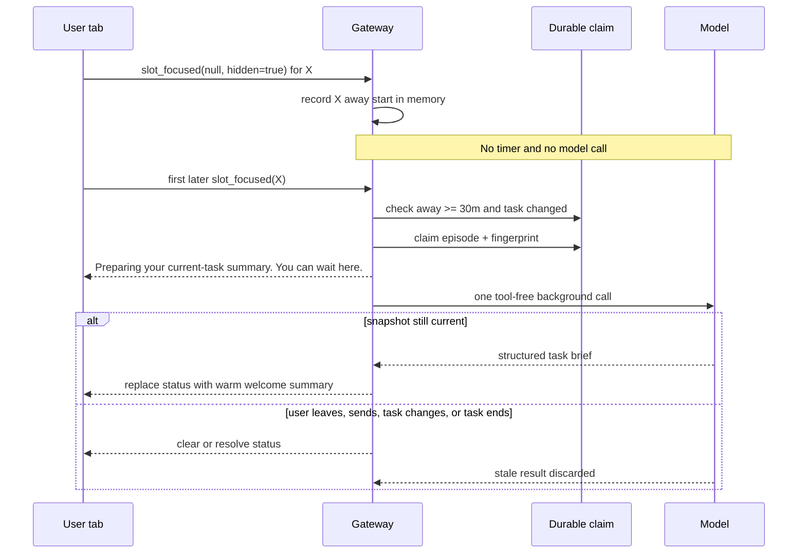

# RFC: Return-triggered warm task brief — replace the immediate warm resume

- Status: `accepted`. Maintainer `iamwhatever` [accepted the direction and explicit-signal false-negative tradeoff](https://github.com/kirodotdev/KiroCrew/pull/20157#issuecomment-6167061835) on 2026-10-14: cold welcome stays unchanged; the user must leave, stay away for at least 30 minutes, and return; the return shows deterministic status before one model call; stale or cancelled work clears that status without publishing its result.
- Audited on `d06b611f549d` (`main`, 2026-10-14).
- This amends only the **warm** branch of [rfc-crewmate-greeting.md](rfc-crewmate-greeting.md) and [rfc-crewmate-greeting-as-message.md](rfc-crewmate-greeting-as-message.md). Their cold-welcome decision remains fully in force.

## 1. Problem

The current warm resume appears as soon as a crewmate chat with an open task is opened. It is assembled from fixed client copy and work-ledger counts. It does not begin with the request that caused the work, and it can appear while a newer answer is about to land.

The useful moment is a real return: the user left Kiro Crew, stayed away long enough to lose task context, and came back. Only that return should spend a model call and welcome the user with the original request, current task truth, and the next move.

## 2. Current behavior, verified

When `useMateGreeting` opens a confirmed idle crewmate thread, it immediately reads `GET /api/crew-board`. An open work-ledger item produces `MateResumeCard`, rendered through `ChatPane.crewmateGreeting` as a host-drawn message after the transcript. It uses no model call and writes no transcript row. The same hook takes a separate cold branch only when no goal is in flight.

Kiro Crew already has an owner-gated foreground lifecycle. `attachFocusRelay` sends `slot_focused` over the existing authenticated WebSocket; first connect and reconnect re-announce it through `reconnectCatchUp`; a hidden tab sends `slot: null`; and the server stores one foreground slot per owner connection through `slot_retention.note_foreground`. The Crewmates page separately uses `document.hidden`, `document.hasFocus()`, `window` focus/blur, and `viewedThread` to register a member thread only while it is on screen. `slot_read` is not presence: `_handle_slot_read` is a pure unread-badge relay and stores no read state.

The current foreground seam does not yet express the full return contract. It re-announces `chat.activeSlot`, while a member thread lives in `viewedThread`; it sends blur for a hidden document but not every focus loss or page leave; and it stores no away start. The implementation extends this existing owner presence seam. It does not infer presence from message age, `slot_read`, a client clock, or an ambient “active” flag.

Before this RFC changed anything, focused tests passed on the audited base: 62 backend tests in `test_agent_welcome_message.py` plus `test_mate_welcome.py`, and 45 frontend tests in `mateGreeting.test.ts`, `useFirstGreeting.test.tsx`, and `ChatPane.scrollChrome.test.tsx`. Existing `MembersPage` and WebSocket tests also pin visible/focused `viewedThread` registration, hidden-tab retirement, first-connect focus, and reconnect focus re-announcement.

## 3. Decision

### 3.1 Warm only

Replace only the immediate warm resume. A crewmate chat with an active task no longer draws fixed task status merely because the thread opened.

Every cold-welcome path remains exactly as it is on the audited base:

- `useMateGreeting` still takes the cold branch only when no work-ledger goal is in flight.
- `COLD_AFTER_MS` remains six hours.
- `GET /api/members/{slug}/recap`, `MateWelcomeCard`, its copy, hide action, once-per-idle-stretch rule, failure notice, and user-visible placement remain unchanged.
- `useFirstGreeting`, `POST /api/members/{slug}/greet`, `dashboard.mate_welcome`, the `first_greeting` create flag, and Mate's first model welcome remain unchanged.
- Agent-spec `welcomeMessage` reading, dashboard display, KAS projection, bundled values, and agent-switch behavior remain unchanged.

This RFC does not remove a welcome from a new or cold chat. It changes only the active-task warm resume.

### 3.2 Exact trigger: leave, 30 minutes away, return

A delayed warm task brief is eligible only when all conditions hold in order:

1. The gateway receives `{type: "slot_focused", slot: null, hidden: true}` from the last owner connection whose foreground row names thread X.
2. Thread X stays in that in-memory away episode for at least 30 continuous minutes.
3. The first later owner `slot_focused` frame names thread X; a frame naming anything else ends the episode without a call.
4. On that return, thread X has an open task and a durable original user request.
5. No earlier warm-brief attempt claimed the same durable task fingerprint.

The **return frame** is the trigger. Thirty minutes passing is not a trigger. No periodic timer runs.

| State | Status or model call |
|---|---|
| Page remains visible for 30 minutes or longer | None |
| Page remains visible but window loses focus | None |
| Page remains hidden for 30 minutes or longer | None until a real return |
| User returns before 30 minutes | None |
| Focus event repeats while already foreground | None |
| Another tab already shows the thread | None |
| Switch chats and stay 30 minutes or longer | None |
| Open a non-chat route for 30 minutes or longer | None |
| Leave the New crewmate card open for 30 minutes or longer | None |
| Focus a split-view placeholder pane | None |
| Hide on thread X, return on Y, then open X later | None |
| User returns after 30 minutes, fingerprint already claimed | None |
| First eligible return, or return after task-state change | One claimed warm-brief attempt |

Thirty minutes is the accepted minimum. The implementation names it once as `WARM_TASK_BRIEF_AWAY_SECS = 30 * 60`. It is an away-duration check on a return edge, never a wake timer or repeat cadence.

### 3.3 Trusted presence and multiple tabs

The client extends the existing `slot_focused` frame with one optional reason bit, `hidden: true`. It is valid only with `slot: null`, and only the existing `visibilitychange` hidden branch sends it. The flag says why presence cleared; it supplies no time or duration.

- On a chat route, the presence sender continues to report `chat.activeSlot`.
- On the Crewmates route, a separate mounted-thread presence value reports the confirmed member thread while the document is visible, regardless of window focus. The existing focus-aware `viewedThread` value remains unchanged and serves unread badges only.
- First connect and reconnect use that mounted-thread value on the Crewmates route and `chat.activeSlot` elsewhere, but send no focus frame while `document.hidden` is true. The later `visibilitychange` return sends the real return frame.
- Window focus may re-announce the same slot. Window blur sends nothing. Chat switches, member-thread switches, non-chat routes, the New crewmate card, split-view placeholder focus, page teardown, and socket cleanup keep their existing `slot_focused` behavior but never add `hidden: true`.
- Frames keep the existing WebSocket origin, owner, and app-token checks. The server accepts no client-supplied time or duration.

`document.hidden` is also the sole desktop authority; no native Electron IPC is added. The dashboard's `WebContentsView` leaves `backgroundThrottling` at its default `true`. Electron's [Page Visibility contract](https://www.electronjs.org/docs/latest/api/browser-window#page-visibility) says minimized or explicitly hidden windows report hidden on every platform, and fully occluded windows report hidden on macOS. Therefore macOS minimize, hide-to-tray, and full occlusion can arm; Windows and Linux minimize or `win.hide()` can arm; partial occlusion, side-by-side windows, and unfocused documents that remain visible do not. If a compositor does not report hidden, no brief appears—the accepted explicit-signal false negative.

The implementation pins that controllable premise with an Electron source test that the dashboard view never sets `backgroundThrottling: false`. Release smoke checks minimize and hide-to-tray on macOS, Windows, and Linux; it records platform variance but does not add a second presence authority.

The server updates the existing per-connection foreground registry for every owner `slot_focused` frame. It starts thread X's away episode only when a `hidden: true` null arrives from the last owner connection whose existing row names X. Other nulls, slot replacements, and socket-finally cleanup may clear or replace registry rows for their existing jobs, but they never arm a warm brief.

The gateway stores X's away start and episode generation in memory. The first later owner focus frame ends that episode. It is a return only when it names X; a frame naming Y or null drops X's episode without a call. Return-time gates then require 30 minutes, an open task, a real original request, and a task fingerprint not already claimed. This placement lets a task begin or worker progress land while the user is away.

A normal tab close first fires `visibilitychange` to hidden and sends the hidden-leave while the socket is open. That send remains best-effort. If it is lost, or a crash, power loss, sleep, socket loss, or gateway restart erases the in-memory episode, that return can miss a warm brief. Maintainer `iamwhatever` explicitly accepted those false negatives rather than adding socket-gap inference. The ordinary chat and unchanged cold welcome remain available.

Only the qualifying task fingerprint claim is durable. Claim-before-status prevents duplicate spend across repeated focus, simultaneous tabs, reload, or restart after a return was admitted. Away detection remains in the existing in-memory foreground registry.

### 3.4 Status before the model

On an eligible return, the gateway re-reads the durable task snapshot and atomically claims the away episode plus task fingerprint. Only a current, unclaimed snapshot proceeds.

The gateway then emits this deterministic user-visible status before starting the model call: **“Preparing your current-task summary. You can wait here.”** Producing this status uses no model and no token. It travels on the existing owner WebSocket as `warm_task_brief_status` with the slot and one of `preparing`, `unavailable`, or `clear`; no new route or listener is added.

The status is a bounded transient task-brief state, not an assistant answer and not permanent transcript history. It has one lifecycle:

| Event after status | Visible result |
|---|---|
| Model result stays current | Status is replaced by the warm task brief |
| User sends, leaves, resets, closes, or replaces the chat | Status clears silently; stale result is discarded |
| Worker/task state changes, a new assistant answer arrives, or the task completes/cancels | Status clears silently; stale result is discarded |
| Model fails, times out, or returns invalid data | Status becomes “I couldn't prepare the current-task summary.”; no canned brief appears |

The unavailable status remains only until the next transcript/task event or until the user leaves that chat, then clears. It is not persisted. Every stale or cancelled path clears preparing before any old result can publish; the new user, assistant, or task state already visible in the chat is the explanation, so no second terminal message is added.

There is deliberately no `MateResumeCard` fallback; maintainer `iamwhatever` accepted silence when the explicit leave signal is lost, and cold welcome remains available under its unchanged rules.

### 3.5 Durable input and output

The model prompt snapshot is built on the gateway from existing durable local state:

1. **Original request:** the first genuine user request for the active task, quoted verbatim when it fits the existing transcript-summary user-text bound, otherwise faithfully quoted with an explicit truncation mark. The model never chooses a different origin.
2. **Current task:** the session ledger's `goal`, `phase`, `next`, recent event tail, and artifacts when present; the work ledger's item title, state, worker status, last truthful worker summary, decision, verdict, and artifacts when present; and bounded recent user/assistant transcript turns for context.
3. **Next steps:** one to three actions inferred from that snapshot.

Missing state stays missing. The prompt forbids invented work, progress, percentages, dates, deadlines, elapsed-time claims, and ETAs. Worker transcript text is not read; only the report the worker deliberately wrote to the shared work ledger is eligible.

The model returns a small structured result. The gateway validates it, replaces its original-request field with the exact source quote, caps the current-state facts and suggestions, and applies existing display redaction. The visible result has exactly three parts: **Original request**, **Current task**, and **Next steps**. Next steps contain one to three items. Empty or malformed output produces no task brief.

A successful brief replaces the transient status with one durable transcript `notice` row tagged `warm_task_brief`. It is rendered as the warm task brief, is not attributed to the selected crewmate or replayed as user/assistant model history, and survives reload through the existing transcript path. Existing redaction runs before persistence. The durable claim and row fingerprint prevent reload from regenerating or duplicating it.

### 3.6 One bounded model call

The warm task brief uses `llm_helpers.run_bg_oneliner` with the governed background model, a bounded prompt, a bounded output, a timeout, and no tools. This is the existing model path: no new provider, endpoint, listener, bind, ingress rule, credential path, or third-party data send is added.

Each completed or failed attempt is charged to the owning session as `warm_task_brief` background work, using the existing input-token, output-token, credit, and duration accounting. The Usage view and crew log therefore show the spend.

The old warm resume used no tokens. The replacement can spend one background model call on one eligible return for each materially changed task snapshot. It spends nothing while visible, while hidden, on a short return, on repeated focus, when another tab remains foreground, for cold welcome, for unchanged state, for terminal work, or for a duplicate claim.

### 3.7 Deduplication, cancellation, and stale results

A canonical task fingerprint covers the original-request identity, the latest genuine user or assistant task row, session-ledger revision, and work-ledger report revision. It contains hashes and sequence values, not copied user text. The transient `warm_task_brief_status` never enters it, and durable `notice` rows tagged `warm_task_brief` are explicitly excluded, so publishing a brief cannot make its own task look changed.

Before emitting status or calling the model, the gateway atomically claims the task fingerprint in protected derived state and consumes the in-memory away episode. Claim-before-status means repeated focus, two returning tabs, reconnect replay, or gateway restart cannot show two status rows or spend twice on the same task snapshot. A crash after the claim may lose that brief, but cannot loop and spend again while nothing changed.

A later hidden-leave → 30 minutes away → return cycle is eligible only when its task fingerprint differs from the last claimed attempt. No previous claim makes the first eligible return valid. A new user message or worker event can change the fingerprint, but does not itself trigger a call; the next qualifying return does.

The gateway rechecks the foreground episode, slot identity, task fingerprint, and terminal state before status, before the model call, and before publication. Any mismatch clears the status and discards the result. Best-effort cancellation may stop the model call early; publication suppression is the hard guarantee when cancellation arrives too late.

## 4. Timing

## 5. User-visible shape

Before this change, opening an active-task chat shows the immediate fixed warm resume.

| Scenario | Result after change |
|---|---|
| Open active-task chat | No immediate warm resume |
| Stay on page for 30 minutes | No new warm welcome |
| Leave window unfocused but page visible | No away episode and no warm welcome |
| Stay away for 30 minutes | No work while away |
| Return after 30 minutes, changed task | Preparing status, then one grounded warm welcome |
| Return after 30 minutes, unchanged task | Nothing |
| Tab/browser close, crash, or sleep sent no leave update | No warm brief; accepted false negative |
| Gateway restarts during away period | No warm brief; accepted false negative |
| Candidate changes after status | Status clears; stale result never appears |
| Open cold chat | Unchanged cold welcome |

## 6. Spend and privacy

Prompt input can include the user's original request, bounded transcript excerpts, session-ledger state, and shared work-ledger reports. All input stays within the model provider and account already configured for Kiro Crew. No project code, transcript, ledger, credential, or user data is sent to a new service. Existing transcript privacy modes still win; an incognito or otherwise derivation-withheld transcript is ineligible.

The implementation PR body must repeat this spend statement, name the 30-minute away threshold, state that return is the only trigger, and state that deterministic status costs no model call.

## 7. Authorization and exposure

This change adds no route. It extends an existing owner-only WebSocket presence frame and its server registry. Existing WebSocket origin checks, dashboard authentication, owner/audience checks, app-token denial, transcript privacy checks, provider authorization, and model governance remain unchanged. No listener, public bind, port publication, ingress rule, storage ACL, or auth bypass is added or weakened.

The source fingerprint and durable claim are gateway-owned derived state. They contain no raw request or ledger text, use owner-only storage, follow transcript purge/reset rules, and are never served as an authorization input. The away start stays in memory and is never written.

## 8. Validation

The implementation uses focused tests only.

- A before/after test proves an active-task chat emits no immediate warm resume.
- Existing cold-welcome tests remain unchanged and pass, proving every cold path and visible behavior stayed intact.
- **Visible for 30 minutes or longer:** no status and no model call.
- **Visible but window-unfocused for 30 minutes or longer:** no away episode, status, or model call.
- **Hidden for 30 minutes or longer before return:** no status and no model call.
- **Return before 30 minutes:** no status and no model call.
- **Duplicate focus or multiple tabs:** one return edge, one status, and one model call.
- A return-boundary test proves the deterministic status is visible before `run_bg_oneliner` starts and costs no model call itself.
- A result test proves the warm welcome contains the exact original request, truthful current task state, and one to three next steps.
- A state test runs two qualifying away/return cycles with no external task change and proves one model call: `warm_task_brief_status` and the persisted `warm_task_brief` notice never alter the fingerprint.
- Race tests prove a user send, a second leave, worker/task change, newer assistant answer, completion, or cancellation clears or resolves status and suppresses the stale result.
- Status-copy tests pin silent clearing for every stale/cancelled path and the exact unavailable text for failure, timeout, or invalid output; that unavailable status clears on the next transcript/task event or chat leave.
- Lifecycle tests prove reload, reset, close, slot replacement, timeout, model failure, and invalid output leave no permanent preparing state; a gateway restart during away loses the in-memory episode and makes no call.
- Reconnect tests prove a hidden first connect/reconnect sends no focus frame and cannot return; the later visible transition sends the only return frame.
- Presence tests prove chat routes report `chat.activeSlot`; the Crewmates page reports a separate visible mounted thread regardless of focus; focus-aware `viewedThread` remains unread-only; only `slot_focused(null, hidden=true)` from the last connection arms away; app sockets cannot arm it.
- Negative presence tests prove chat/member switches, non-chat routes, an open New crewmate card, split-view placeholder focus, and socket cleanup create no episode or call; hiding on X then returning on Y consumes X's episode, so opening X later makes no call.
- Electron tests pin that the dashboard view does not set `backgroundThrottling: false`; release smoke checks minimize and hide-to-tray on macOS, Windows, and Linux, while occluded-but-visible and unfocused windows make no synthetic signal.
- Privacy and security tests prove derivation-withheld transcripts are skipped, the call is tool-free, existing auth is unchanged, and no new network surface exists.
- Run targeted backend and frontend tests plus lint and type checks for touched packages; do not run the full pytest suite.

## 9. Rollout and undo

1. Merge this RFC first, with `status: accepted`, so the implementation reads the decision from its base.
2. Land one implementation PR for the warm branch, trusted return detection, an in-memory away episode, a durable return claim, transient status lifecycle, focused tests, system docs, locale changes, and spend statement.
3. Do not use a First Principles override. Do not merge the implementation until PR Readiness is green.

Undo is one implementation revert. The cold branch never changes. Reverting removes return detection, status, and the model call, then restores the immediate warm resume. Persisted fingerprint claims become inert derived data and follow normal transcript purge; in-memory away state disappears with the process.

## 10. Non-goals

- Changing any cold-welcome trigger, read, copy, component, placement, failure state, repeat rule, or user-visible result.
- Changing Mate's first welcome, dashboard-created crewmate greetings, or the greet route.
- Changing custom-agent `welcomeMessage` behavior or KAS projection.
- Calling an LLM because 30 minutes passed.
- Running a periodic 30-minute timer.
- Calling an LLM while the page is visible, while it is hidden, or on a return under 30 minutes.
- Adding a new model provider, external service, route, listener, auth path, or data destination.
- Inventing progress, percentages, deadlines, or ETAs.

## 11. Alternatives considered

- **Thirty-minute idle timer.** Rejected: idle is not return. It would spend while the user stayed on the page or was still away.
- **Client-supplied away timestamp.** Rejected: tabs and clocks disagree, and the gateway already owns authenticated per-connection foreground state.
- **Treat socket disconnect as leave.** Rejected: a network outage is not proof the user left.
- **Use `slot_read` as return.** Rejected: it is a throttled, best-effort unread relay and stores no presence.
- **Delay the fixed warm card.** Rejected: it still lacks the original request and cannot explain the task in current terms.
- **Start the model before showing status.** Rejected: the user would see an unexplained wait, and a status that appears later would lie about when work began.
- **Retry a claimed return.** Rejected: automatic retry can repeatedly spend while nothing changes. A changed task and a new qualifying away/return episode are the retry boundary.

## 12. Decision record

Accepted by maintainer `iamwhatever` on 2026-10-14 in [the maintainer decision comment](https://github.com/kirodotdev/KiroCrew/pull/20157#issuecomment-6167061835), with these terms: warm only; cold unchanged; leave, at least 30 minutes away, then return as the sole trigger; no visible-idle, hidden, short-return, periodic, socket-gap, or reconnect inference; silence is accepted when sleep, restart, or network loss loses the explicit leave signal; deterministic visible status before the model call; stale/cancelled results suppressed with status cleared; original request, current state, and one to three next steps in the warm welcome; durable dedup and no-repeat spend rules retained.